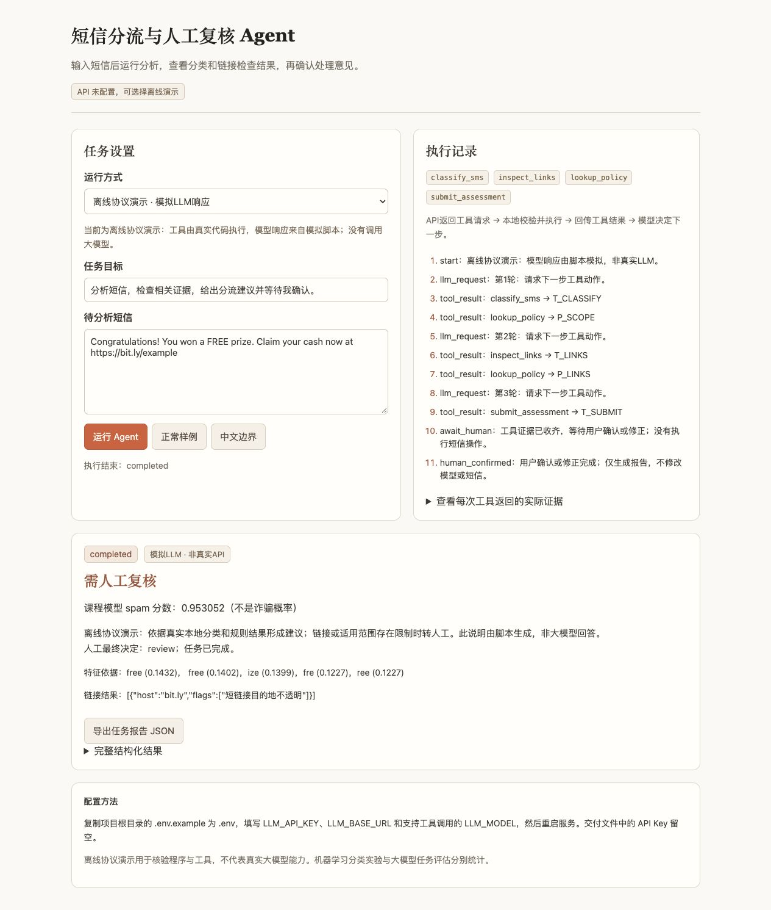

# 短信分流与人工复核 Agent

机器学习课程项目。**大模型通过工具调用执行任务，本地TF-IDF＋逻辑回归提供分类证据，用户确认或修正后完成任务。** 原离线分类与规则流程保留为对照。API Key与模型ID默认留空；真实大模型尚未联网实测，交付不包含密钥或伪造的LLM结果。

## 运行

建议Python 3.12。模型与公开数据已提供。首次安装需要网络。

```sh
python3 -m venv .venv
source .venv/bin/activate  # Windows: .venv\Scripts\activate
python -m pip install -r requirements.txt
python src/app.py
```

打开 http://127.0.0.1:8765 。默认选中真实API模式；未配置时返回`configuration_required`。可以明确选择“离线协议演示”，验证工具执行、人工确认和报告导出；该模式的模型响应由脚本模拟，不是大模型输出。仅加载随项目提供的可信joblib文件。

## 配置真实大模型

```sh
cp .env.example .env
```

在`.env`中填写自己的配置，API Key只在本地填写，禁止提交：

```dotenv
LLM_API_KEY=
LLM_BASE_URL=https://api.openai.com/v1
LLM_MODEL=
LLM_TIMEOUT_SECONDS=30
LLM_MAX_TURNS=6
```

`LLM_MODEL`填服务商实际提供、支持Chat Completions函数工具调用的模型ID。`LLM_BASE_URL`为服务商HTTPS根路径（通常包含`/v1`，不含`/chat/completions`）。环境变量优先于.env。配置后重启。这里提供OpenAI兼容协议，不承诺所有兼容服务都支持相同工具schema；不支持时应更换支持工具调用的模型或服务，而不是删除证据检查。

真实模式会把短信、任务目标与工具结果发给该API服务；界面已提示。密钥不进入浏览器、任务结果或公开文件。不访问短信中的URL，不发送或删除短信。

```sh
# 有密钥时，真实大模型工具调用
python src/app.py --mode llm --text "Free prize cash now https://bit.ly/example"
# 无密钥时，模拟模型响应，但执行真实本地工具
python src/app.py --mode demo --text "Free prize cash now https://bit.ly/example"
# 原传统工作流对照
python src/app.py --mode local --text "Free prize cash claim now"
```

## Agent如何执行

1. 读取`docs/SKILL.md`作为任务技能，提供用户目标、原始短信和工具schema。
2. 请求模型返回下一步动作，`tool_choice=auto`；工具顺序由模型返回值决定。
3. 校验函数白名单、JSON参数和任务边界，执行本地工具。
4. 以`role=tool`和匹配的`tool_call_id`把实际结果回传模型，进入下一轮。
5. 模型调用`submit_assessment`，执行器检查分类、规则及必要的链接证据是否齐全。风险与意见冲突强制转人工。
6. 进入`pending_review`；用户确认或修正后进入`completed`，可导出JSON任务报告。

最多6轮请求（可配置1至10）、16次工具调用；每次网络请求有超时。普通聊天文本不能绕过工具直接完成任务。没有开放shell、文件路径或任意联网工具。这里实现的是有边界的任务型LLM Agent，不是通用自主助手。

| 工具 | 输入 | 实际能力 |
|---|---|---|
| classify_sms | 无参数，绑定任务原文 | 真实本地分类、分数、特征、英文适用性 |
| inspect_links | 无参数，绑定原文 | 静态域名与短链等标志；不联网 |
| lookup_policy | scope/links/uncertainty/privacy | 读取项目操作规则及可引用ID；不是权威反诈知识库 |
| submit_assessment | action、summary、evidence_ids | 核验依据、提交建议、等待人工确认 |

## 验证和证据边界

```sh
python -m unittest discover -s tests -v
python src/evaluate_llm_contract.py
# 仅在配置密钥且愿意发送config/live_eval_cases.json中的公开构造样例时运行
python src/evaluate_llm_live.py
```

45项软件测试通过，含原18项和新增27项。5类模拟协议任务调用真实工具并经人工确认状态接口完成。HTTP传输使用替代响应核验消息序列、参数、回传结果；**真实API调用次数为0，不报告真实LLM任务完成率、质量、时延或费用**。`results/llm/contract_evaluation.json`记录范围与代码哈希；`browser_*.json`和下方截图来自实际浏览器操作的离线协议模式。真实评估脚本需密钥，其输出保存在默认不公开的`local_runs/`。



## 课程机器学习实验

公开数据原始5574条，规范化分组去重后5137条；训练/验证/测试为3082/1027/1028。仅训练集拟合词表和模型；验证集选出字符LR。独立测试Precision=0.9655、Recall=0.9032、F1=0.9333。词LR F1=0.9212，多数类0，关键词0.5417。模型冻结，没有因为加入LLM而重新选择测试结果。

原`model_only`、`reject_only`、`full_agent`三行是**离线基线流程的消融**，不代表新LLM版本；拒判没有减少测试错误。LLM不会替代课程模型输出未经评估的中文分类概率。大模型调度是否改善实际用户任务尚待真实API与用户任务验证。

```sh
python src/experiment.py             # 重训，会覆盖模型和主结果
python src/plot_results.py
python src/extended_experiments.py  # 55次CV拟合、15次学习曲线拟合等补充分析
```

图表采用暖白底、陶土橙、橄榄绿与沙色，公共样式在`src/figure_style.py`；点形与线型也用于区分数据。图表依赖中文字体；Linux可安装fonts-noto-cjk。补充实验结果保存在`results/extended/`，图在`figures/extended/`；均为冻结主结果后的探索性分析。

## 文档导航

正式报告包含Agent工具循环、数学方法、主要实验与运行演示；逐条误判、完整记录和接口细节在仓库中：

- [实验补充说明](docs/实验补充说明.md)：数据清洗、参数表、55次交叉验证拟合、学习曲线、阈值分析、全部16条误判和8张实验图。
- [Agent设计](docs/LLM_AGENT.md)：模型选工具、结果回传、证据检查、人工确认及当前验证范围。
- [接口与配置](docs/接口说明.md)：配置字段、HTTP请求、返回状态及导出方法。
- [组件与许可证](docs/THIRD_PARTY.md)：依赖版本、来源、许可和适配说明。
- [答辩提纲](docs/答辩提纲.md)：演示步骤和常见问题。

实现入口为src/llm_agent.py与src/app.py；课程模型在src/core.py。主实验见results/metrics.json，补充实验见results/extended/，软件测试和浏览器记录见results/llm/。

## 限制与来源

只验证英文历史spam分类。没有近期中文诈骗数据、真人用户实验或线上LLM效果数据。静态标志不能验证网站安全；人工确认也不自动使建议正确。LLM摘要可能出错；规则和工具白名单限制操作权限，但不保证完全消除提示注入影响。复核状态仅驻留内存，最多100条，服务重启后清除；可导出本次报告，不自动训练或永久保存私人短信。

数据：Almeida & Hidalgo (2011), SMS Spam Collection, UCI, DOI https://doi.org/10.24432/C5CC84 ，CC BY4.0。API协议参照[OpenAI官方函数调用文档](https://developers.openai.com/api/docs/guides/function-calling)，采用Python标准库自行适配，没有复制SDK或引入第三方Agent框架。详见`docs/LLM_AGENT.md`。

公开仓库：https://github.com/Ali-Xiyao/sms-triage-agent-course-project 。仓库只发布代码、公开数据与演示材料，正式身份报告仅在本地提交包中提供。
