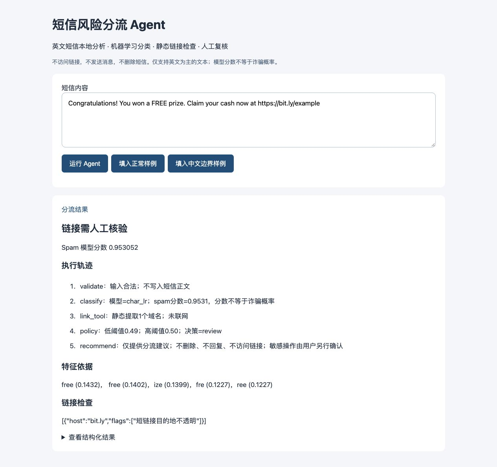
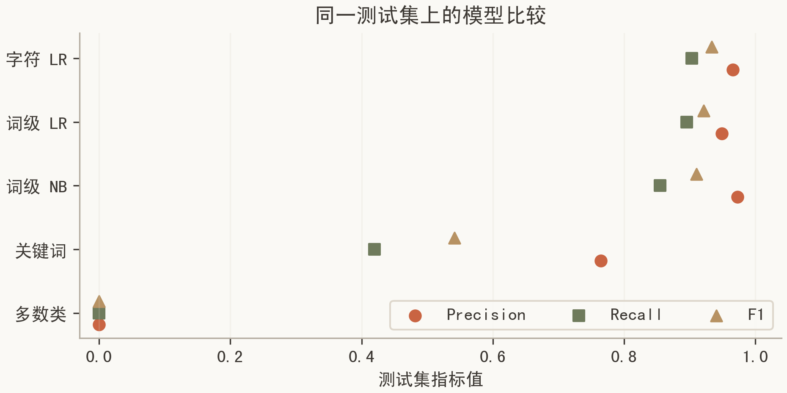

# 短信风险分流与人工复核 Agent

机器学习课程期末项目。本地、离线、可解释的英文短信分流原型。输入一条短信，输出正常/垃圾短信倾向或人工复核、模型特征贡献、静态链接检查和完整状态轨迹。**不自动删除、不发短信、不访问链接；模型分数不是诈骗概率。**

## 快速运行

建议 Python 3.12 或 3.13（依赖锁定按实际实验环境生成；SciPy 需平台对应的预编译 wheel）。在此目录执行：

```sh
python3 -m venv .venv
source .venv/bin/activate  # Windows: .venv\Scripts\activate
python -m pip install -r requirements.txt
python src/app.py
```

浏览器访问 http://127.0.0.1:8765。模型和公开数据已随项目提供，推理无需联网。首次安装依赖需要网络。仅加载本项目受信任的 joblib 文件，不加载陌生来源的 pickle/joblib。

```sh
# 命令行完整运行
python src/app.py --text "Free cash prize claim now"
# 重新训练和全部主实验；会覆盖 models/ 与 results/ 下的生成文件
python src/experiment.py
# 验证核心流程与边界
python -m unittest discover -s tests -v
# 重新生成图表
python src/plot_results.py
```

绘制中文图表需安装中文字体（优先SimHei或Noto Sans CJK SC）；Linux可安装fonts-noto-cjk。脚本会检测字体并给出提示，Agent推理和测试不依赖中文字体。

## 项目结构

- `src/core.py`：状态工作流、解释、输入边界、链接工具、人工复核策略。
- `src/experiment.py`：公开数据解析、规范化去重、固定划分、三模型训练、两基线、拒判消融、bootstrap、扰动测试和逐条预测。
- `src/app.py`：本地界面、`POST /api/triage` 接口和 CLI，监听回环地址。
- `tests/test_agent.py`：模型、异常、越界、工具故障、隐私和划分隔离测试。
- `models/model.joblib`：实际训练生成的模型及验证集所选阈值。
- `results/metrics.json`：唯一数字结果源；`splits.csv`：样本哈希与划分；`test_predictions.csv`：全部测试预测；`errors.csv`：全部误判；`demo_trace.json`：完整演示轨迹。
- `data/`：UCI 公开数据及原始说明，不含个人采集短信。
- `docs/`：设计、组件分析、来源、演示截图、答辩提纲。
- `figures/`：实验结果 PNG/SVG 图。

## 实验约束

原始短信来自 UCI SMS Spam Collection，ham/spam 二分类。先将大小写、空白、数字串、URL规范化产生去重键，冲突标签组删除，再按类别分层划分60%训练/20%验证/20%测试（种子42）。模型只在训练集拟合词表和IDF；验证集选模型和阈值；测试集只评估。主模型未使用验证集重新拟合，以免验证阈值失效。

指标将 spam 当作正类。自动覆盖率分母是全部测试任务，接受正确率分母仅为未转人工的任务。人工复核不计作正确分类。比较 `model_only`、`reject_only`、`full_agent`，同时披露人工负担与漏分流数量。Bootstrap区间仅描述固定测试集的抽样变动，不能代表跨时代或跨语言泛化。

## 限制与来源

仅英文垃圾短信识别；历史数据不能证明对2026年诈骗有效。中文、多语言、无已知特征输入回退人工。没有真人用户试验、没有时间节省实测。相似模板可能仍跨集合，诊断数量见metrics；不能宣称完全消除模板泄漏。

数据：Almeida & Hidalgo (2011), SMS Spam Collection, UCI, DOI https://doi.org/10.24432/C5CC84 ，CC BY 4.0。完整依赖、来源、许可和复用边界见 `docs/THIRD_PARTY.md` 和报告附录。生成式AI参与代码、实验设计、文档起草与调试；结果由实际运行记录支撑，提交者需自行阅读并能解释实现。

## 已运行结果与演示

公开数据原始5574条，规范化分组去重后5137条；训练/验证/测试为3082/1027/1028。验证集选出字符级LR，测试Precision=0.9655、Recall=0.9032、F1=0.9333。多数类基线F1=0，关键词基线F1=0.5417。18项核心测试通过；当前拒判策略未减少测试错误，局限已保留。详细结果见results/metrics.json。





## 在线仓库

https://github.com/Ali-Xiyao/sms-triage-agent-course-project

此仓库仅提供代码、公开数据、实验记录和演示，不包含学生身份信息或正式提交报告。AI辅助范围和组件归属在本文及docs/THIRD_PARTY.md披露。
