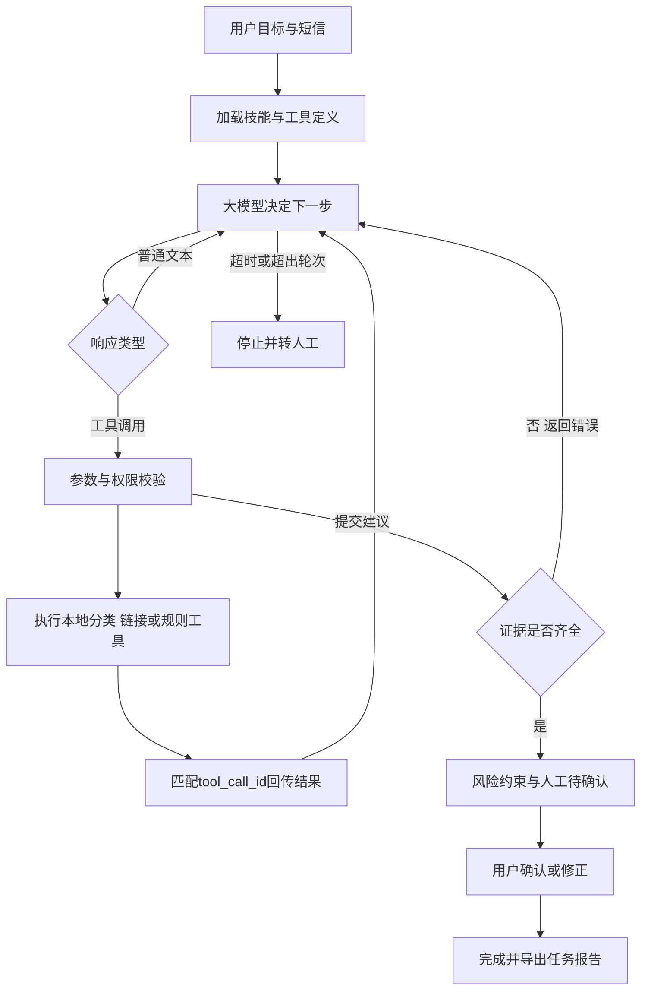

# 大模型任务执行设计

## 与传统流程的区别

传统模式将分类、链接检查和策略合并写成固定顺序。LLM模式保留任务权限和完成条件，但不把每次工具顺序写死：客户端返回什么合法tool_calls，执行器就执行什么，再把实际结果交还模型。模型可以先查规则，也可以先分类；看到链接再检查，看到错误可修正参数；只有符合证据约束的提交才能结束自动阶段。

这里的计划是模型逐轮选择的工具动作，不展示或保存隐藏思维链。执行轨迹只记录请求轮次、工具名、证据ID、约束与状态。工具的参数绑定原文，LLM不能传另一个短信骗取不同分类结果。

## 模块契约

`ChatClient.complete(messages, tools)`发送HTTPS POST到`LLM_BASE_URL/chat/completions`。载荷含model、messages、tools、tool_choice=auto、max_tokens。内部工具schema使用strict=true；DeepSeek标准端点适配时删除beta strict标记并关闭思考模式，执行器校验保留；对象additionalProperties=false，所有属性进入required。按照官方协议保存assistant.tool_calls，并逐条加入role=tool、tool_call_id和JSON结果。已验证DeepSeek Flash官方端点；其他服务兼容性仍需验证。

只从服务器环境或项目根目录.env读密钥。配置缺失不会创建客户端网络请求。连接超时、401、429或5xx等错误以类别返回，不记录原始响应正文。禁止跟随HTTP重定向，避免携带Authorization头跨站。返回体最多2MB。客户端不自动重试已计费请求；普通文本响应和参数错误可在轮次预算内由模型继续。

`docs/SKILL.md`确实在每次任务中读取并注入系统消息。它是本项目编写的任务契约，不能称作第三方开源技能复用。检索工具从knowledge/policies.json按有限主题读取规则；这些是项目操作规则，不提供对恶意网站或发送者的外部事实证明。

## 完成条件

必须取得并引用T_CLASSIFY和至少一个已检索规则ID；含URL时还须取得T_LINKS。submit_assessment必须单独调用，防止模型在尚未观察同轮其他结果时提交。模型可以选择更保守的review，但不能无复核地反转课程模型标签。分类越界、模型/工具故障或链接标志会强制转人工。摘要由模型生成，证据ID校验无法证明其每句话均准确，因此人工需检查摘要与工具结果。

pending_review只是自动阶段完成；只有用户通过/api/review确认或修正后成为completed。用户的决定独立保留，完成只代表建议被处理，不表示短信真实类别已验证正确。确认不会向短信系统发送任何动作，也不会把少量人工标签自动用于训练。

## 三种模式和验证范围

| 模式 | 模型响应来源 | 工具 | 当前验证 |
|---|---|---|---|
| llm | 用户配置的真实API | 相同真实本地工具 | 修复40次、新任务100次、重复30次与真实浏览器闭环 |
| demo | ProtocolDemoClient脚本 | 相同真实本地工具 | 已实际运行浏览器闭环；明确标注模拟 |
| local | 无LLM | 固定分类与链接工作流 | 原分类实验、边界与消融 |

52项测试包含：真实工具分支、改输入参数拒绝、伪造证据拒绝、跳过链接检查拒绝、未知工具拒绝、模型与分类器冲突转人工、普通文本不能结束、重复ID拒绝、API错误处理、HTTPS与重定向限制、HTTP消息回传、人工修正与重复确认、容量边界，以及原18项测试。5类协议场景全部符合契约，不能称为5例真实LLM成功。

真实API入口src/evaluate_llm_live.py，20条公开构造任务；只允许官方DeepSeek Flash端点，限制预算和请求数。初版和修复版分别58次有效响应、18/20符合预设动作。分类器未重训，阈值从0.49/0.50原样作为工具证据补全；针对性摘要错误从4条降至0条。模型仍可主动转人工，这可能偏离预期，按失败保留。详见[真实实验](真实Agent实验.md)。

`ChatClient.events`只采集响应ID、模型ID、usage、工具调用和简短内容，不保存凭据或隐藏思维链。公开结果经检查为构造样本；日常个人短信运行结果默认不发布。

## 与评分标准的关系

- 机器学习：保留训练、独立测试、基线与误差分析，LLM必须调用课程模型。
- Agent：目标输入、模型选工具、执行与观察循环、证据约束、人工确认、完成状态和导出形成任务闭环。
- 工具数据：真实本地分类、URL解析和版本化规则读取。
- 复用：实际采用并深入分析K-Dense scikit-learn开发技能，7项审计；API协议有官方来源；不把自编技能说成外部成果。
- 评估：分类质量、软件契约、浏览器操作与真实LLM功能任务结果分别统计。

公开Key保持为空，本地真实模式已用有效配置运行；复现者自行配置。20条任务不足以保证教师现场的所有输入成功，不以篇幅或调用数量预测分数。

## 来源

OpenAI. Function calling. https://developers.openai.com/api/docs/guides/function-calling ，核对日期2026-11-07。使用的是公开API协议，没有分发大模型权重、SDK源码或服务凭据。使用服务时应遵循所选提供商的条款。

DeepSeek Tool Calls https://api-docs.deepseek.com/guides/tool_calls/ ，2026-11-08核对。实际配置采用deepseek-flash非思考模式。

## 扩展实测

100条新任务（80条随机公开测试短信＋20条新构造任务）均取得必需证据；80条原标签匹配75条，local为77条，3条spam漏判未减少。10条额外各跑3次，动作均一致而工具名序列仅7条一致。170次批量任务共493请求，保守估算0.3157美元，详见真实Agent实验.md。
