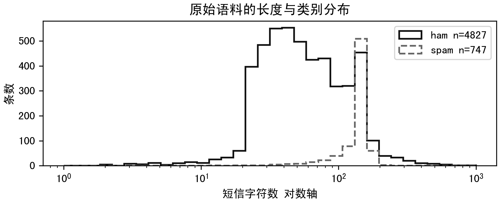
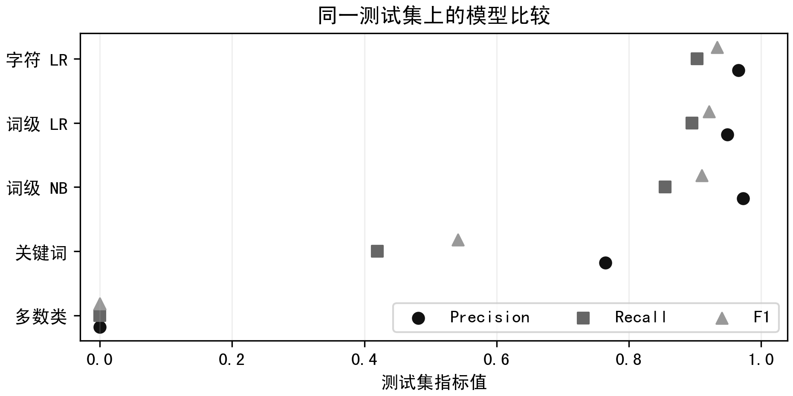
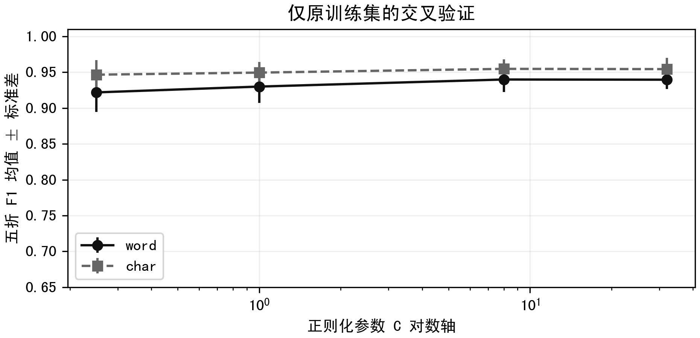
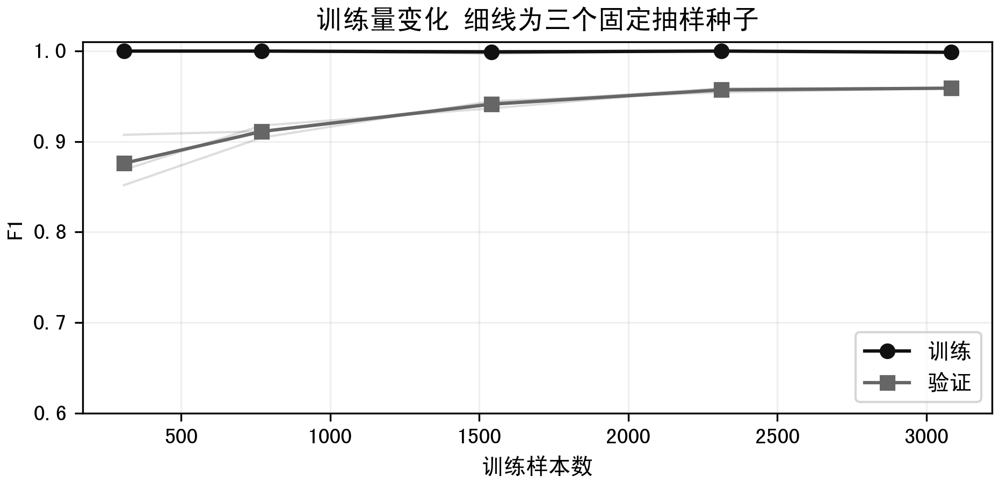
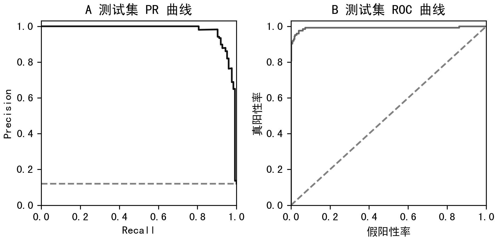
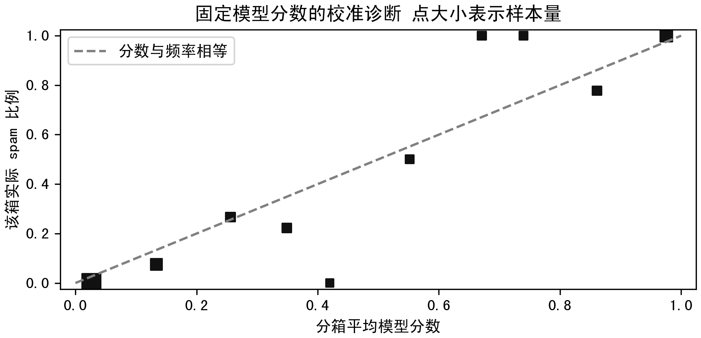
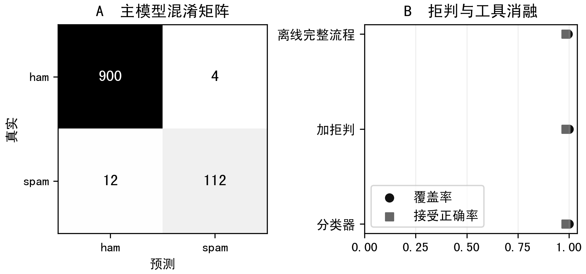
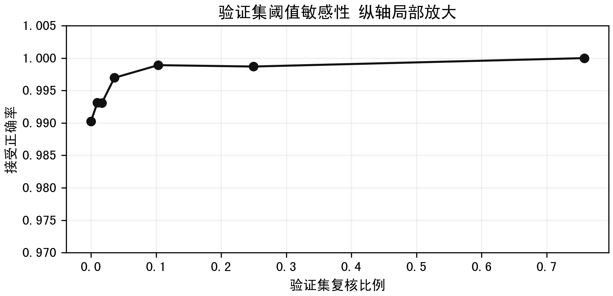

# 实验补充说明

本文档保留正式报告省略的参数、逐条误判、数据划分说明和完整图表。数据均来自项目中已保存的实验记录，加入大模型调度后没有重新选择分类模型。大模型执行与当前验证范围见[LLM Agent说明](LLM_AGENT.md)。

## 1 数据来源与划分控制

采用UCI SMS Spam Collection公开英文短信语料[1]。实际归档解析得到5574条，其中spam为747条；数量以下载文件为准，而非直接照抄网站概述。数据许可为CC BY 4.0，保留作者、来源、原始说明及修改说明。训练不使用私人短信，界面任务记录仅暂存内存，重启后清除；导出的错误样例对号码、邮箱和链接做规则脱敏，但规则脱敏不能保证删除全部个人线索。

先将文本小写化，URL和连续数字替换为占位符，压缩空白，得到分组键；此规范化仅用于分组去重，模型仍读取原始文本。去除标签不一致的组，再在每组保留一个代表，避免重复模板仅更换号码后跨集合。共排除0个冲突组，合计移除437条，最终5137条中spam为620条。该处理可能合并具有不同语境的文本，也是数据清洗的局限。

| 集合 | 短信数 | spam数 | 用途 |
| --- | --- | --- | --- |
| train | 3082 | 372 | 拟合特征与模型 |
| validation | 1027 | 124 | 选择模型及拒判阈值 |
| test | 1028 | 124 | 最终报告结果 |

固定随机种子42，分层比例约为60∶20∶20。词表和IDF只在训练集学习，遵循训练测试隔离原则[5]。测试对训练的最大余弦相似度超过0.9的样本仍有28条，说明规范化不能完全消除近重复，也没有作者或时间分组信息可供更严格划分。报告因此将结果限定为该划分下的历史数据表现。

### 1.1 类别与文本长度的探索分析

训练前首先检查类别数量与文本长度，目的是识别评价陷阱，而不是据此挑选有利的测试样本。ham占多数，因此恒预测正常也能获得较高准确率。短信长度差异可能反映促销文本、联系方式与模板化通知的写作方式，但这些观察只是语料关联，不能据此把所有长短信归为垃圾。

| 原始类别 | 数量 | 平均字符数 | 中位字符数 | 90%分位字符数 |
| --- | --- | --- | --- | --- |
| ham | 4827 | 71.5 | 52.0 | 147.0 |
| spam | 747 | 138.7 | 149.0 | 160.0 |

| 字符模型表示统计 | 实际值 |
| --- | --- |
| 训练文档数 | 3082 |
| 词表维数 | 25893 |
| 训练矩阵非零元素 | 392604 |
| 非零密度 | 0.492% |
| 每条训练短信平均活跃特征 | 127.4 |
| 测试零向量数 | 0 |

稀疏密度说明多数特征在单条短信中并不出现，采用CSR存储可以避免为所有零值分配密集空间。字符片段比完整单词更容易共享局部形式，但也可能在无关文本中碰到常见片段，因此“存在已知特征”并不等价于“输入处于训练分布”。零向量检查只是最低限度的边界，仍需要语言限制和人工复核。

### 1.2 清洗顺序与数据泄漏检查

本项目先建立规范化键，再进行数据划分。规范化键统一大小写、空白、URL和数字串，其作用是把仅替换号码或链接的模板识别为同组。模型训练读取的文本仍是原始字符串，没有将所有号码替换后再拟合分类器。区分“去重用表示”和“预测用表示”，能够避免文档中的数据处理说明与实际代码不一致。

| 可能的泄漏路径 | 本项目控制 | 尚存边界 |
| --- | --- | --- |
| 重复短信分到两侧 | 规范化去重后再划分 | 语义近重复仍可能保留 |
| 测试词进入训练词表 | Pipeline在训练子集fit | 无法避免公开语料研究偏差 |
| 利用测试选模型 | 主模型由原验证集选出 | 补充分析发生于主结果之后 |
| 调阈值追求测试成绩 | 敏感性分析仅使用验证集 | 不能反复查看后宣称全新盲测 |
| 交叉验证前拟合IDF | 每折重新拟合整个Pipeline | 折间仍来自相同语料来源 |

补充实验沿用splits.csv中的哈希ID读取数据，并逐条检查固定模型分数与原test_predictions.csv一致。这样可避免由于重新随机划分而把两次实验误当成同条件比较。数据清洗确实使用了全量标签检查冲突组，这是对标注一致性的预处理，不是完全与标签无关的无监督清洗；本次冲突组数为零，所以没有因此排除任何冲突标签样本。

近重复诊断采用已冻结字符表示，计算每条测试短信与训练集的最大余弦相似度。相似度大于0.9的28条记录作为一个分析子组，其他1000条构成另一子组。该分组用于观察结果是否依赖近似模板，不用于重新挑选测试集，也不能替代真正按发送者、来源或时间隔离的评估。

## 2 机器学习方法与参数

TF-IDF通过训练语料的文档频率降低常见词权重[2]。本项目设置sublinear_tf=True，使用1+ln(tf)抑制词语重复；平滑IDF采用ln((1+N)/(1+df))+1，再对文档向量进行L2归一化。词级模型保留一元与二元词组，字符模型在词边界内取3至5字符片段。min_df=2只保留至少出现于两篇训练文本的特征，字符词表最多40000维。稀疏矩阵使短文本训练无需密集存储整个词表。

比较多项式朴素贝叶斯和逻辑回归。NB以类条件独立假设累计词特征证据，并通过alpha=0.1平滑[4]；LR将线性得分经sigmoid映射为分类分数，通过带正则的对数损失拟合，设置C=8、class_weight=balanced、max_iter=1000[3]。balanced增大少数类的损失权重，有助于关注spam召回，也可能增加正常短信误报，需用Precision共同检查。

| 模型 | 表示 | 主要配置 |
| --- | --- | --- |
| word_nb | 词1至2元 TF-IDF | alpha=0.1 |
| word_lr | 词1至2元 TF-IDF | C=8，balanced |
| char_lr | char_wb 3至5元 TF-IDF | 最多40000维，C=8，balanced |
| majority | 恒预测ham | 不学习文本 |
| keyword | free/prize/winner/claim/cash | 任一子串命中即spam |

主实验的所有学习模型共享训练、验证和测试样本，只按验证集spam F1选择主模型，随后冻结模型与阈值。新增五折参数比较只在原训练集进行，学习曲线和阈值敏感性只使用原验证集，不替换部署模型。补充分析发生在主结果之后，属于探索性复核，不能追溯表述为最初预注册实验，也无法证明参数全局最优。

准确率表示整体预测正确比例；Precision衡量spam预测的可信度，Recall衡量垃圾短信被找回多少，F1是二者调和平均。另报告ROC-AUC与平均精确率AP，以反映分数排序能力。模型分数未在独立校准集上校准，不能解释为个体短信的真实风险概率。

### 2.1 从文本到决策分数的数学过程

设训练集中共有N条短信，某特征t在短信d中出现tf次，并在df条训练短信中出现。开启对数词频后，非零词频转为1+ln(tf)，再乘以平滑逆文档频率。只在训练集估计df，可防止测试文本影响特征权重。完整向量按L2范数归一化，使短信长度不直接支配向量尺度。

idf(t) = ln((1 + N) / (1 + df(t))) + 1
v(t,d) = (1 + ln(tf(t,d))) × idf(t)
x(d) = v(d) / ||v(d)||₂

逻辑回归将特征向量x映射为线性得分z，再经sigmoid得到spam分数。分类训练最小化加权二元交叉熵与L2正则项。类别权重提高少数类样本的训练贡献；C控制正则化强度的相反方向，C越大通常约束越弱。本文档以实际软件求解器为准，不把下式中的正则常数视为库内部精确缩放的复刻。

z = b + Σⱼ wⱼxⱼ
s(x) = 1 / (1 + exp(−z))
损失 = 加权二元交叉熵 + L2正则项

对词级NB，训练通过不同类别下特征的累计频次构造条件分布；平滑减少未见词导致的零概率。TF-IDF是连续非负权重，将其用于多项式NB属于常见的加权文本表示用法，但不意味着加权值本身是严格的整数多项式计数。比较NB和LR时，评价由独立预测结果决定，而不是由模型假设的直观吸引力决定。

解释模块使用wⱼxⱼ展示特征对z的方向和大小。对于字符模型，片段“fre”与“free”可能同时出现，贡献存在冗余，不是互相独立的因果因素。界面只显示绝对值最大的五项，因此这五项之和再加截距通常不等于完整模型得分；完整得分还包含未展示的非零特征。

### 2.2 参数选择与训练实现细节

主实验首先固定三个候选配置，分别训练词级NB、词级LR与字符级LR，再以原验证集spam F1选择部署模型。原始模型文件保留，不因补充分析而替换。补充的交叉验证回答参数是否敏感、模型是否依赖一次划分等问题，不能追溯改写为最初就进行过的搜索。

| 设计选择 | 作用 | 可能代价 |
| --- | --- | --- |
| min_df=2 | 排除仅见一次的特征 | 可能丢失少数类新词 |
| 词1至2元 | 保留词汇与局部搭配 | 对变体和缩写较敏感 |
| 字符3至5元 | 共享词形局部片段 | 解释较碎片化 |
| 40000维上限 | 限制表示与计算规模 | 依赖频次截断 |
| balanced权重 | 关注少数类训练损失 | 可能提高正常短信误报 |
| max_iter=1000 | 提供充分迭代上限 | 并非实际迭代次数 |

训练脚本将特征转换和学习器封装为Pipeline，所以调用fit时会先学习词表和IDF，再拟合分类系数；调用predict_proba时只执行transform与预测，不更新任何参数。交叉验证也对整个Pipeline进行折内拟合，而不是先在全部训练数据上向量化再交叉验证分类器。后者会让折外文档影响词表与IDF，从而削弱评估的独立性。

模型持久化采用joblib，部署只读取固定的models/model.joblib。模型、特征映射和两个阈值保存在同一bundle中，避免手工复制参数时发生错配。复现时应先核对数据归档哈希、库版本与划分文件，再比较数值；若换用其他库版本，不应直接假定序列化兼容或分类结果逐位相同。

## 3 Skills与组件复用分析

本项目没有复用第三方短信Agent；新增模型调度通过兼容API实现，并强制调用课程分类工具。第三方复用重点是scikit-learn的文本分类工具；短信分流SKILL.md、工具循环、证据约束、拒判、解释和界面由本项目实现。SKILL.md在LLM任务中实际读取并加入系统消息。自编技能不是第三方开源复用成果，二者在清单中明确区分。报告构建借助python-docx，图表借助Matplotlib，不属于在线推理权限或外部服务。

深入核验对象为TfidfVectorizer与Pipeline。阅读已安装版本的text.py和pipeline.py及官方API：前者在fit阶段学习词表和IDF，在transform阶段输出CSR矩阵；后者依次执行特征变换和分类。Pipeline能保持训练推理一致，但并不包含语言边界、隐私、重试或人工确认。项目的适配工作是设置字符片段及词表上限、引入类别权重，并在外层增加无已知特征与组件故障回退。源码身份和哈希记录在component_audit.json。

| 复用项 | 版本或标识 | 许可及具体用途 |
| --- | --- | --- |
| scikit-learn | 1.7.2 | BSD-3-Clause  特征与学习器 |
| NumPy / pandas | 2.3.5 / 2.3.3 | BSD-3-Clause  统计与表格 |
| SciPy / joblib | 1.18.1 / 1.5.2 | BSD-3-Clause  稀疏计算与持久化 |
| Matplotlib | 3.10.7 | Matplotlib license  结果图 |
| UCI短信语料 | 2011  哈希见附录文件 | CC BY 4.0  公开训练评估数据 |

训练需读取本地公开数据并写入模型；本地分类与离线演示只加载固定模型，不需密钥；真实LLM模式需要配置网络服务和密钥，但不接入短信账户。joblib反序列化只用于本项目可信文件，界面不允许上传模型。行为核验包含模型缺失、注入链接工具异常、OOV输入、中文输入和短链接覆盖；消融比较模型、拒判和完整流程，检验编排的独立作用。完整来源链接和许可文本在附录及docs/licenses中保留[6]。

### 3.1 组件核验与复用边界

开源组件并非在安装后即可视为已完成集成。项目核验需要说明输入输出、状态变化和失败语义。例如，TfidfVectorizer可以返回零向量，却不会主动判断文本是否支持；Pipeline提供一致的变换顺序，却不会处理中文越界；urlsplit只拆解字符串，不能确认域名对应的网站是否可信。因此，工作流层的校验不是对库功能的简单重复。

| 组件行为 | 核验方法 | 本项目增加的适配 |
| --- | --- | --- |
| 词表与IDF | 源码阅读和训练测试隔离 | 固定划分及哈希对齐 |
| 概率列顺序 | 数据标签0/1与predict_proba约定 | 明确spam对应第2列 |
| 序列化 | 固定可信路径加载 | 缺失模型转人工 |
| 静态URL解析 | 短链 IP 域名形态样例 | 异常捕获与review覆盖 |
| 解释输出 | 稀疏值和系数逐项乘积 | 方向说明与五项截取 |
| 边界契约 | 单元测试及手工场景集 | 无效与越界分别编码 |

source_basename与source_sha256保存已安装组件的源码身份，不能把这份哈希当作整个第三方包供应链已被安全审计的证明。本文没有复制第三方库源码冒充原创，版权和许可保持原有归属。文档生成使用python-docx与docxcompose，后者只负责合并学校封面和正文，不参与短信推理，其许可副本随代码提供。

自主实现的部分主要是场景约束、样本分组、实验组织、静态链接工具、策略覆盖、特征解释和本地界面。复用的部分主要是数值运算、文本表示、分类学习器和数据集。这样的贡献划分将工程整合与算法创新区分开来，避免仅因使用多种工具就宣称提出了新的学习算法。

## 4 分类实验与结果

测试集共1028条，全部样本参与，spam为正类。主模型char_lr由验证集选出。下表为固定0.5分类阈值的结果；Agent的拒判效果单独计算，避免将转人工当作分类成功。主模型F1的1000次bootstrap百分位95%区间为[0.8976, 0.9641]，仅体现固定模型在该测试集重采样的不确定性，不包含重新训练或分布漂移误差。

| 方法 | Accuracy | Precision | Recall | F1 | AP |
| --- | --- | --- | --- | --- | --- |
| majority | 0.8794 | 0.0000 | 0.0000 | 0.0000 | 0.1206 |
| keyword | 0.9144 | 0.7647 | 0.4194 | 0.5417 | 0.3907 |
| word_nb | 0.9796 | 0.9725 | 0.8548 | 0.9099 | 0.9533 |
| word_lr | 0.9815 | 0.9487 | 0.8952 | 0.9212 | 0.9666 |
| char_lr | 0.9844 | 0.9655 | 0.9032 | 0.9333 | 0.9758 |

多数类方法虽然准确率为0.8794，spam召回为零，说明单看准确率会掩盖关键失败。主模型ROC-AUC为0.9902，混淆矩阵按真实ham/spam为行、预测ham/spam为列，得到[[900, 4], [12, 112]]。这同时暴露正常短信误报与垃圾短信漏判。不同特征表示的相对优劣以表中实测值为准，不能将更复杂的模型直接等同于更好。

### 4.1 原训练集五折交叉验证

补充实验仅在原3082条训练短信内进行分层五折交叉验证，shuffle=True，固定种子2026。每次以四折训练、一折评价，且每折重新拟合词表和IDF。词级与字符级LR分别比较C为0.25、1、8、32的配置，词级NB比较alpha为0.01、0.1、1。共11个配置，每个配置得到5个折内分数，共55次拟合。[9]

| 表示与模型 | C或alpha | Precision均值 | Recall均值 | F1均值 | F1标准差 |
| --- | --- | --- | --- | --- | --- |
| word | 0.25 | 0.9093 | 0.9355 | 0.9219 | 0.0274 |
| word | 1 | 0.9303 | 0.9302 | 0.9300 | 0.0230 |
| word | 8 | 0.9531 | 0.9275 | 0.9399 | 0.0177 |
| word | 32 | 0.9582 | 0.9221 | 0.9396 | 0.0130 |
| char | 0.25 | 0.9643 | 0.9301 | 0.9466 | 0.0203 |
| char | 1 | 0.9643 | 0.9355 | 0.9495 | 0.0149 |
| char | 8 | 0.9751 | 0.9355 | 0.9547 | 0.0134 |
| char | 32 | 0.9804 | 0.9301 | 0.9544 | 0.0155 |
| nb | 0.01 | 0.9855 | 0.9034 | 0.9422 | 0.0221 |
| nb | 0.1 | 0.9940 | 0.9007 | 0.9448 | 0.0219 |
| nb | 1 | 1.0000 | 0.6345 | 0.7761 | 0.0186 |

标准差描述五个折分数的离散程度，不是95%置信区间，也不代表五次独立数据采集。由于训练折高度重叠，不能将折数当作独立样本数直接做常规显著性检验。交叉验证表为对固定配置的补充证据，最终部署模型仍保持原验证集选择的字符LR与原阈值。

### 4.2 正则化强度与表示方式的关系

补充交叉验证中，最高平均F1的配置为char，参数为8，平均F1为0.9547，折间标准差为0.0134。该结果用于描述在当前训练样本上的敏感性，不作为替换部署模型的依据，更不能将交叉验证最高分直接写成最终测试成绩。

C过小时，系数受到更强约束，可能无法充分利用少数类特征；增大C后，模型能更积极拟合训练模式，但在稀疏文本上也可能放大偶然片段。字符表示与词表示具有不同的特征共享方式，相同C不必对应相同复杂度。因此，观察曲线形状比孤立地报告某个参数更有解释价值。

误差线若重叠，只能说明本图没有给出清楚的稳定分离证据，不能据此证明两模型等价；误差线不重叠也不自动构成统计显著性。若需要正式比较，应设计外部测试、配对重采样或适当的统计检验，并提前规定比较方案。本文不追加没有完成的显著性结论。

### 4.3 训练样本量与泛化差距

学习曲线固定字符LR配置，在原训练集中抽取约10%、25%、50%、75%和100%的样本。前四个比例分别使用种子11、42和2026进行分层抽样，所有模型都在相同原验证集上评价；100%三次使用相同训练数据，重复值不代表三份独立数据。绘图保留各条抽样曲线，不把少量种子的均值包装为总体置信区间。

| 训练比例 | 样本量 | 训练F1均值 | 验证F1均值 |
| --- | --- | --- | --- |
| 10% | 308 | 1.0000 | 0.8760 |
| 25% | 770 | 1.0000 | 0.9112 |
| 50% | 1541 | 0.9991 | 0.9413 |
| 75% | 2311 | 1.0000 | 0.9571 |
| 100% | 3082 | 0.9987 | 0.9590 |

若训练得分较高但验证得分较低，说明模型对已见文本的拟合不能直接外推；随样本量增加的验证表现，可用于判断继续补数据是否可能有价值。曲线没有包含近期跨语言短信，因此即便验证F1上升，也只能说明当前语料内的学习趋势，不能推出对新诈骗话术的适应能力。

### 4.4 排序能力与概率分数的诊断

ROC曲线描述不同阈值下真阳性率与假阳性率的变化；PR曲线更直接呈现垃圾短信预测的精确率和召回权衡。虚线分别表示无信息参考：PR图使用测试spam比例，ROC图使用对角线。两张曲线都使用固定模型原始分数，不重新训练或调参。

AP与ROC-AUC评价分数排序，不直接决定用户会看到多少错误建议。一个模型可以具有很好的AUC，但在特定阈值上仍漏掉部分垃圾短信。因此，报告保留0.5阈值的混淆矩阵，同时单独展示拒判后的覆盖率。不能用排序指标替代实际工作点的误报、漏判与人工负担。

### 4.5 分数校准与样本量限制

模型分数按0.1宽度分箱，横坐标为箱内平均分数，纵坐标为箱内实际spam比例。固定测试集Brier分数为0.01440。该分数同时受到区分能力、可靠性和数据不确定性的影响，不能把较低Brier分数直接等同于“概率已校准”。本节是诊断，没有使用测试标签训练校准器。[10]

| 分数区间 | 样本数 | 平均分数 | 实际spam比例 |
| --- | --- | --- | --- |
| 0.0至0.1 | 821 | 0.026 | 0.001 |
| 0.1至0.2 | 66 | 0.134 | 0.076 |
| 0.2至0.3 | 15 | 0.256 | 0.267 |
| 0.3至0.4 | 9 | 0.349 | 0.222 |
| 0.4至0.5 | 1 | 0.420 | 0.000 |
| 0.5至0.6 | 4 | 0.552 | 0.500 |
| 0.6至0.7 | 6 | 0.671 | 1.000 |
| 0.7至0.8 | 3 | 0.740 | 1.000 |
| 0.8至0.9 | 9 | 0.861 | 0.778 |
| 0.9至1.0 | 94 | 0.975 | 1.000 |

样本很少的分箱会产生很不稳定的正类比例，不能把一个点偏离对角线解释为可推广的精确误差估计。若未来要改善概率解释，应另留校准数据或使用训练集内的交叉校准，并在未参与校准的外部数据上评价。本版本继续显示“模型分数”，保留其能力边界。

## 5 拒判消融与实际任务指标

本节的model_only、reject_only和full_agent均指原离线基线流程，不是新增LLM版的运行结果。分流任务允许主动停止自动判断。自动覆盖率是输出likely_ham或likely_spam的条数除以全部任务数；接受正确率仅在这些自动建议上计算。review和invalid均不计自动成功。无人工复核实测标签修正，因此没有把转人工后的任务视为已完成；拒判系统的价值必须与复核负担一起呈现。

| 流程 | 自动覆盖率 | 接受正确率 | 漏分为正常 | 误分为spam |
| --- | --- | --- | --- | --- |
| model_only | 100.00% | 98.44% | 12 | 4 |
| reject_only | 100.00% | 98.44% | 12 | 4 |
| full_agent | 99.61% | 98.44% | 12 | 4 |

原完整离线基线将0.39%的样本转交人工，自动覆盖1024条，其中垃圾短信漏分为正常12条，正常误分为spam4条。本次拒判阈值仅形成0.49至0.50的窄区间，测试集中没有分数落入区间；完整流程转人工的少量样本来自边界或链接规则，且未减少错误。故本次证据并不支持拒判带来精度提升，经验纯度约束仍需改进。静态链接工具只检查显式链接与少量域名形态，不将无标志的链接视作可信；它的贡献主要体现为可解释的流程约束，不能用此表宣称已验证网页恶意检测能力。

### 5.1 验证集阈值敏感性与复核负担

为解释原双阈值为何几乎没有产生拒判，补充分析预先列出七组由宽到窄的阈值区间，只在原验证集上计算覆盖率、接受正确率和错误数。它是主实验完成后的探索性分析，不据此改变部署策略，也不把验证集上的最佳表现作为最终测试结果。

| 低阈值 | 高阈值 | 覆盖率 | 接受正确率 | 复核数 | 漏正常 | 误spam |
| --- | --- | --- | --- | --- | --- | --- |
| 0.01 | 0.99 | 24.25% | 100.00% | 778 | 0 | 0 |
| 0.05 | 0.95 | 75.07% | 99.87% | 256 | 1 | 0 |
| 0.1 | 0.9 | 89.68% | 99.89% | 106 | 1 | 0 |
| 0.2 | 0.8 | 96.40% | 99.70% | 37 | 3 | 0 |
| 0.3 | 0.7 | 98.34% | 99.31% | 17 | 6 | 1 |
| 0.4 | 0.6 | 99.03% | 99.31% | 10 | 6 | 1 |
| 0.49 | 0.5 | 100.00% | 99.03% | 0 | 7 | 3 |

扩宽中间区间通常会减少自动覆盖，但是否提高被接受建议的准确性仍由实际数据决定。正常侧纯度约束受多数类占比影响较大，即使总体纯度很高，仍可能存在值得关注的垃圾短信漏判。因此，未来策略应同时约束少数类漏判及正常误报，并为复核成本设定明确预算。当前结果不足以声称已经解决风险与人工负担之间的最优权衡。

## 6 失败样例与鲁棒性

| 真实与预测 | 模型分数 | 脱敏文本片段 |
| --- | --- | --- |
| 0 → 1 | 0.526 | Please protect yourself from e-threats. SIB never asks for sensitive information like Passwords,ATM/ |
| 1 → 0 | 0.112 | TBS/PERSOLVO. been chasing us since Sept for£38 definitely not paying now thanks to your information |
| 1 → 0 | 0.269 | You can donate £2.50 to UNICEF's Asian Tsunami disaster support fund by texting DONATE to 864233. £2 |
| 0 → 1 | 0.533 | Sir, i am waiting for your call, once free please call me. |

上表按测试集原始顺序在每种真实类别中最多取两例，完整错误均保留在errors.csv，避免只展示成功案例。短文本往往缺少充分词汇证据，正常交流可能讨论奖品或免费活动，垃圾短信也可能使用普通会话措辞。词袋与字符片段无法读取发送者身份、历史往来和语境，这是模型层的主要限制。规则可能要求复核合法短链，这是工具层的保守代价。

| 测试输入变换 | Precision | Recall | F1 |
| --- | --- | --- | --- |
| 原文 | 0.9655 | 0.9032 | 0.9333 |
| uppercase | 0.9655 | 0.9032 | 0.9333 |
| space_noise | 0.9655 | 0.9032 | 0.9333 |
| digit_mask | 0.9643 | 0.8710 | 0.9153 |

扰动实验对全部测试文本进行大写化、加倍空白和数字替换，标签沿用原标签，仅作为标签保持近似下的压力测试。大写不敏感通常来自向量器预处理；数字替换测试号码模式依赖。该结果不是对真实攻击的评测。工程边界另外用手工测试覆盖空输入、超长、类型异常、中文、未知词、模型缺失和工具失败；这些样例不混入公开分类测试集，不用于宣称真实短信泛化能力。

已有证据支持的改进是由词级逻辑回归改为字符级逻辑回归：验证F1从0.9431提高到0.9590，测试F1从0.9212提高到0.9333。拒判消融没有减少测试错误，不能宣称其已提高准确率。下一步可收集经许可的近期、跨语言和来源分组语料，开展时间外测试，再独立校准分数；在获得这些数据之前，不应扩大适用范围。

### 6.1 不同输入子组的错误分布

补充子组评价使用固定测试集，不改变模型。长度分组边界设为50和150字符；URL按显式http、https或www模式判断；模板相似度分组使用最大训练余弦相似度0.9。每组分别报告样本数和spam数，避免把小样本组与大组的指标直接等量比较。

| 测试子组 | 样本 | spam | Precision | Recall | F1 | FP | FN |
| --- | --- | --- | --- | --- | --- | --- | --- |
| length_le_50 | 443 | 4 | 0.667 | 0.500 | 0.571 | 1 | 2 |
| length_51_150 | 454 | 70 | 0.969 | 0.886 | 0.925 | 2 | 8 |
| length_gt_150 | 131 | 50 | 0.980 | 0.960 | 0.970 | 1 | 2 |
| has_url | 17 | 17 | 1.000 | 1.000 | 1.000 | 0 | 0 |
| no_url | 1011 | 107 | 0.960 | 0.888 | 0.922 | 4 | 12 |
| similarity_gt_09 | 28 | 27 | 1.000 | 1.000 | 1.000 | 0 | 0 |
| similarity_le_09 | 1000 | 97 | 0.955 | 0.876 | 0.914 | 4 | 12 |

长度分组、URL分组和相似度分组之间可以重叠，因此不能将整张表所有行的样本数相加作为测试集规模。同一分组维度内部才互斥。尤其是高相似度组只有28条，其指标容易受一条样本影响；该组不能单独证明模型已经解决重复模板问题。

针对短文本错误，增加发送者上下文可能比盲目增加词表更有效，但这需要新的数据权限和隐私设计。针对号码或价格形式依赖，应收集保留标注语义的真实变体，而不是只在测试时机械替换。所有改进都需要新的独立评价，不能把当前错误分析当作改进已验证。

### 6.2 错误样例第1至8条

以下给出固定测试集错误记录中的第1至8条。总计16条错误全部列出，保留原测试顺序，0表示ham，1表示spam。文本只用于解释模型边界，联系方式和链接按项目规则脱敏，截取前120字符以保持可读性。

| 真实与预测 | 模型分数 | 脱敏文本片段 |
| --- | --- | --- |
| 0 → 1 | 0.526 | Please protect yourself from e-threats. SIB never asks for sensitive information like Passwords,ATM/SMS PIN thru email.  |
| 1 → 0 | 0.112 | TBS/PERSOLVO. been chasing us since Sept for£38 definitely not paying now thanks to your information. We will ignore the |
| 1 → 0 | 0.269 | You can donate £2.50 to UNICEF's Asian Tsunami disaster support fund by texting DONATE to 864233. £2.50 will be added to |
| 0 → 1 | 0.533 | Sir, i am waiting for your call, once free please call me. |
| 1 → 0 | 0.158 | In The Simpsons Movie released in July 2007 name the band that died at the start of the film? A-Green Day, B-Blue Day, C |
| 0 → 1 | 0.841 | We have sent JD for Customer Service cum Accounts Executive to ur mail id, For details contact us |
| 0 → 1 | 0.839 | Glad to see your reply. |
| 1 → 0 | 0.257 | Latest News! Police station toilet stolen, cops have nothing to go on! |

这些错误说明相似词汇可能出现在正常交流和促销语境中，字符片段也无法理解完整的交谈意图。分数接近0.5的错误与分数较低的漏判应区分：前者可能适合通过复核策略处理，后者意味着模型本身缺少区分证据。单纯扩大拒判区间不一定能覆盖所有高置信度错误，仍需要数据与表示层面的改进。

### 6.3 错误样例第9至16条

以下给出固定测试集错误记录中的第9至16条。总计16条错误全部列出，保留原测试顺序，0表示ham，1表示spam。文本只用于解释模型边界，联系方式和链接按项目规则脱敏，截取前120字符以保持可读性。

| 真实与预测 | 模型分数 | 脱敏文本片段 |
| --- | --- | --- |
| 1 → 0 | 0.380 | 2/2 146tf150p |
| 1 → 0 | 0.006 | Do you ever notice that when you're driving, anyone going slower than you is an idiot and everyone driving faster than y |
| 1 → 0 | 0.122 | Money i have won wining number 946 wot do i do next |
| 1 → 0 | 0.365 | Goal! Arsenal 4 (Henry, 7 v Liverpool 2 Henry scores with a simple shot from 6 yards from a pass by Bergkamp to give Ars |
| 1 → 0 | 0.297 | 0A$NETWORKS allow companies to bill for SMS, so they are responsible for their "suppliers", just as a shop has to give a |
| 1 → 0 | 0.243 | FROM 88066 LOST £12 HELP |
| 1 → 0 | 0.194 | dating:i have had two of these. Only started after i sent a text to talk sport radio last week. Any connection do you th |
| 1 → 0 | 0.154 | For sale - arsenal dartboard. Good condition but no doubles or trebles! |

这些错误说明相似词汇可能出现在正常交流和促销语境中，字符片段也无法理解完整的交谈意图。分数接近0.5的错误与分数较低的漏判应区分：前者可能适合通过复核策略处理，后者意味着模型本身缺少区分证据。单纯扩大拒判区间不一定能覆盖所有高置信度错误，仍需要数据与表示层面的改进。

### 6.4 手工边界任务与异常路径

手工边界集包含16种功能场景，与原公开测试集分开统计。预期动作依据系统契约规定，并非现实短信的ham/spam人工标注。指令式文本和HTML文本的验收目标是输入始终被当作数据，不执行删除或脚本；它们允许返回多种分流动作，因此其通过不代表预测正确。

| 手工场景 | 预期动作 | 实际动作 | 是否符合 |
| --- | --- | --- | --- |
| empty | invalid | invalid | 是 |
| null | invalid | invalid | 是 |
| number | invalid | invalid | 是 |
| long | invalid | invalid | 是 |
| chinese | review | review | 是 |
| mixed | review | review | 是 |
| unknown | review | review | 是 |
| shortlink | review | review | 是 |
| ip | review | review | 是 |
| punycode | review | review | 是 |
| broken_url | review | review | 是 |
| friendly | likely_ham | likely_ham | 是 |
| prize | likely_spam | likely_spam | 是 |
| instruction | likely_ham / likely_spam / review | likely_ham | 是 |
| html | likely_ham / likely_spam / review | likely_ham | 是 |
| email | likely_ham | likely_ham | 是 |

本次共有16/16个场景符合动作约定。即使全部符合，也只能证明这些具体样例的接口行为。真实语言识别、对抗鲁棒性和浏览器脚本安全仍需要更系统的验证；报告不把少量手工场景通过率合并进公开测试分类指标。

## 参考来源

[1] Almeida T, Hidalgo J. SMS Spam Collection [Dataset]. UCI Machine Learning Repository, 2011. DOI: 10.24432/C5CC84. https://archive.ics.uci.edu/dataset/228/sms+spam+collection

[2] scikit-learn developers. TfidfVectorizer API. https://scikit-learn.org/stable/modules/generated/sklearn.feature_extraction.text.TfidfVectorizer.html

[3] scikit-learn developers. LogisticRegression API. https://scikit-learn.org/stable/modules/generated/sklearn.linear_model.LogisticRegression.html

[4] scikit-learn developers. MultinomialNB API. https://scikit-learn.org/stable/modules/generated/sklearn.naive_bayes.MultinomialNB.html

[5] scikit-learn developers. Common pitfalls and recommended practices. https://scikit-learn.org/stable/common_pitfalls.html

[6] scikit-learn developers. Release 1.7.2 source and license. https://github.com/scikit-learn/scikit-learn/tree/1.7.2

[7] Creative Commons. Attribution 4.0 International legal code. https://creativecommons.org/licenses/by/4.0/legalcode

[8] Python Software Foundation. urllib.parse URL parsing security. https://docs.python.org/3/library/urllib.parse.html#url-parsing-security

[9] scikit-learn developers. Cross-validation. https://scikit-learn.org/1.7/modules/cross_validation.html

[10] scikit-learn developers. Probability calibration. https://scikit-learn.org/1.7/modules/calibration.html

[11] OpenAI. Function calling. https://developers.openai.com/api/docs/guides/function-calling

参考文献1至8核对于2026年11月6日，9至11核对于2026年11月7日。在线stable文档可能变化，实验行为与组件版本以锁定依赖、源码审计和metrics.json为准。数据使用按[7]保留归属；静态URL解析并不验证URL安全性[8]。
